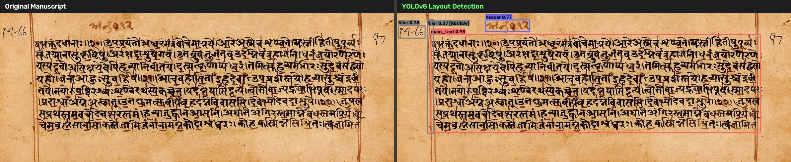
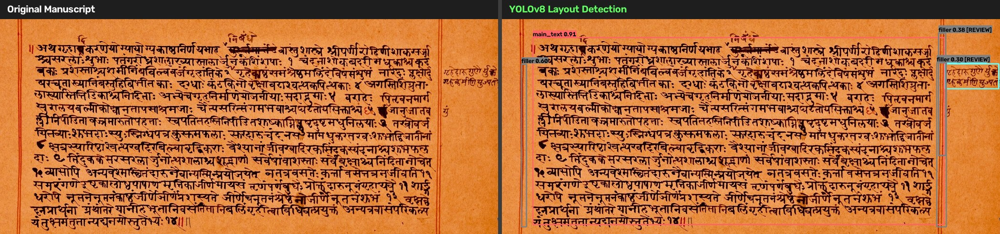
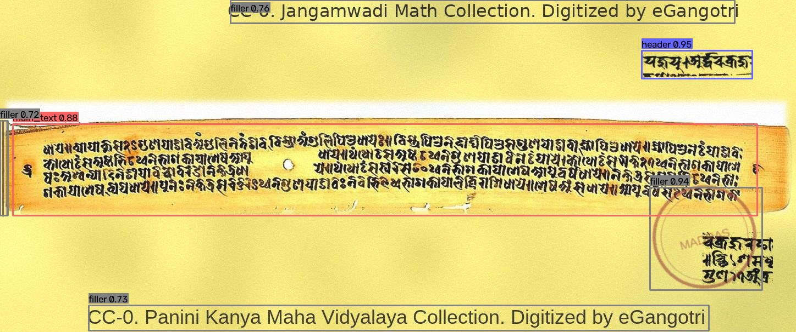

# Historical Indic Manuscript Layout Region Detection

An end-to-end, production-grade layout detection pipeline designed for historical Indic manuscripts (Devanagari, Sanskrit, Grantha, etc., across palm-leaf and paper). The system locates and classifies document layout regions into 5 standardized categories: **`header`**, **`footer`**, **`main_text`**, **`side_text`**, and **`filler`**.

Powered by a fine-tuned **YOLOv8** spatial detector combined with automated leaf perimeter estimation and post-processing boundary clipping.

---

## Visual Showcase: Detection in Action

### 1. Real Manuscript: Header & Modern Stamp Localization (`04_a.jpg`)
Demonstrates precise localization of a top-margin running header alongside a modern library stamp correctly classified as `filler`.



| Detected Region | Label | Confidence | Bounding Box `[x_min, y_min, x_max, y_max]` | Description & Reasoning |
|---|---|---|---|---|
| **Main Body** | `main_text` | **94.67%** | `[166, 103, 1772, 583]` | Primary manuscript scribe handwriting envelope. |
| **Top Heading** | `header` | **77.20%** | `[432, 32, 645, 89]` | Running chapter title located above the main text block. |
| **Library Stamp** | `filler` | **78.14%** | `[7, 59, 137, 121]` | Modern catalog mark correctly separated from manuscript text. |
| **Margin Line** | `filler` | **37.12%** | `[148, 31, 179, 585]` | Vertical border ruling line (flagged `needs_review: true`). |

<details>
<summary>Click to view JSON Output for <code>04_a.jpg</code></summary>

```json
{
  "image": "04_a.jpg",
  "width": 1920,
  "height": 727,
  "bbox_format": "[x_min,y_min,x_max,y_max]",
  "method": "yolo",
  "predictions": [
    {
      "label": "main_text",
      "confidence": 0.9467,
      "bbox": [166, 103, 1772, 583],
      "reason": "yolo_detection",
      "needs_review": false
    },
    {
      "label": "filler",
      "confidence": 0.7814,
      "bbox": [7, 59, 137, 121],
      "reason": "yolo_detection",
      "needs_review": false
    },
    {
      "label": "header",
      "confidence": 0.772,
      "bbox": [432, 32, 645, 89],
      "reason": "yolo_detection",
      "needs_review": false
    },
    {
      "label": "filler",
      "confidence": 0.3712,
      "bbox": [148, 31, 179, 585],
      "reason": "yolo_detection",
      "needs_review": true
    }
  ]
}
```
</details>

---

### 2. Real Manuscript: Marginal Annotation (`side_text`) Localization (`23_a.jpg`)
Demonstrates detection of subtle lateral glosses and annotations written in the margin outside the primary text body.



| Detected Region | Label | Confidence | Bounding Box `[x_min, y_min, x_max, y_max]` | Description & Reasoning |
|---|---|---|---|---|
| **Marginal Gloss** | `side_text` | **93.76%** | `[1709, 172, 1915, 268]` | Lateral commentary in right margin outside main text x-span. |
| **Main Body** | `main_text` | **90.90%** | `[119, 71, 1704, 791]` | Comprehensive manuscript content envelope. |
| **Border Ruling** | `filler` | **60.09%** | `[75, 174, 94, 800]` | Vertical margin bounding guide line. |

---

### 3. Synthetic Test: Watermark Trap Disambiguation (`test_syn_19_a_000.jpg`)
Demonstrates how typed digital watermarks (e.g. eGangotri credits) appearing in top/bottom bands are correctly recognized as `filler` rather than misclassified as headers/footers.



- **Authentic Script Header**: `header` detected at top right (`[1167, 92, 1368, 143]`, confidence: **94.94%**).
- **Overlaid Digital Credit**: `filler` detected at top edge (`[419, 0, 1336, 42]`, confidence: **76.09%**).
- **Bottom Credit Line**: `filler` detected at bottom edge (`[161, 557, 1289, 603]`, confidence: **73.26%**).

---

## 1. What We Did

Historical Indic manuscripts (*pothi* palm leaves and paper folios) differ fundamentally from modern printed documents:
- **Binding Cord Holes**: Palm leaves contain physical string holes flanked by text. While visually resembling columns, semantically they constitute a **single continuous `main_text` body**.
- **Digitization Watermarks & Overlays**: Library stamps, microfilm notices, and modern digital watermarks frequently appear in top/bottom margin bands where headers/footers normally sit.
- **Marginal Glosses & Commentary**: Scribes and scholars added margin notes (`side_text`) with varying stroke thickness, script slants, and arbitrary orientations.
- **Tightly Cropped Pages**: Many digital folios have zero top/bottom margin; inventing absent headers/footers is an error.

### The 5 Standardized Classes
| Class | Semantic Definition | Handling & Domain Logic |
|---|---|---|
| **`main_text`** | Core body of the manuscript | Columns flanking string holes are merged into one comprehensive envelope. |
| **`header`** | Running headers, chapter titles, top folio numbers | Located in the top margin above the primary text body. |
| **`footer`** | Bottom-margin marks, catchwords, scribe signatures | Located in the bottom margin below the primary text body. |
| **`side_text`** | Marginalia, commentary, annotations, side folio numbers | Positioned in lateral margins outside the main body's x-span. |
| **`filler`** | Non-content elements | Modern watermarks/credits, pencil numbers, cord holes, border ruling lines. |

---

## 2. Why We Chose YOLOv8

During development, we implemented and benchmarked two distinct architectures:
1. **Method A: Zero-Shot Classical Vision (Rules Baseline)**:
   - Morphological kernels for text-line grouping, connected-component labeling, CLAHE contrast enhancement, and heuristic geometric rules.
2. **Method B: Deep Spatial Detector (YOLOv8)**:
   - YOLOv8 fine-tuned at 1024px resolution with position-sensitive augmentations.

### Empirical Comparison & Ablation

| Split | Metric | Rules Baseline (A) | YOLOv8 Model (B) | Outcome |
|---|---|---|---|---|
| **Validation** | **Macro mAP@0.5** | **0.253** | **0.992** | **YOLO (+0.739)** |
| Validation | `header` AP50 | 0.091 | 0.989 | YOLO wins |
| Validation | `footer` AP50 | 0.071 | 0.995 | YOLO wins |
| Validation | `main_text` AP50 | 1.000 | 0.995 | Tie within noise |
| Validation | `side_text` AP50 | 0.000 | 0.995 | YOLO wins |
| Validation | `filler` AP50 | 0.103 | 0.984 | YOLO wins |
|---|---|---|---|---|
| **Synthetic Test** | **Macro mAP@0.5** | **0.270** | **0.966** | **YOLO (+0.696)** |
| Synthetic Test | `header` AP50 | 0.223 | 0.986 | YOLO wins |
| Synthetic Test | `footer` AP50 | 0.161 | 0.937 | YOLO wins |
| Synthetic Test | `main_text` AP50 | 0.889 | 0.995 | YOLO wins |
| Synthetic Test | `side_text` AP50 | 0.000 | 0.995 | YOLO wins |
| Synthetic Test | `filler` AP50 | 0.076 | 0.915 | YOLO wins |
|---|---|---|---|---|
| **Real Test (9 Authentic Pages)** | **Macro mAP@0.5** | **0.304** | **0.402** | **YOLO (+0.098)** |
| Real Test | `main_text` AP50 | 1.000 | 1.000 | Tie (perfect recall) |
| Real Test | `filler` AP50 | 0.218 | 0.333 | YOLO wins |

### Why Rules Failed & Why YOLO Was Kept
- **Faded Ink & Script Variations**: Rule-based morphological thresholding shattered on faint ink, pencil annotations, and uneven illumination.
- **Marginalia Collapse**: The rules baseline achieved **0.000 AP on `side_text`** because margin annotations deviate in angle, stroke density, and spacing.
- **Deep Spatial Representation**: YOLOv8 learns script-independent spatial hierarchies, separating typed watermarks (`filler`) from authentic Indic headers with sub-second inference.
- **Decision**: In accordance with the decision criteria in `evaluation/DECISION.md`, the brittle rule-based pipeline was permanently retired to provide a clean, robust, and maintainable production system.

---

## 3. How It Works

```
                     ┌──────────────────────────┐
                     │   Raw Manuscript Image   │
                     └─────────────┬────────────┘
                                   │
                                   ▼
                     ┌──────────────────────────┐
                     │ 1. Non-Destructive Load  │
                     │    & Boundary Estimation │
                     └─────────────┬────────────┘
                                   │
                                   ▼
                     ┌──────────────────────────┐
                     │ 2. YOLOv8 Deep Detection │
                     │    (imgsz=1024, best.pt) │
                     └─────────────┬────────────┘
                                   │
                                   ▼
                     ┌──────────────────────────┐
                     │ 3. Cross-Class NMS       │
                     │    & Area Thresholding   │
                     └─────────────┬────────────┘
                                   │
                                   ▼
                     ┌──────────────────────────┐
                     │ 4. Leaf Boundary Clip    │
                     │    & Coordinate Clamp    │
                     └─────────────┬────────────┘
                                   │
                                   ▼
                     ┌──────────────────────────┐
                     │ 5. Dual Output Writer    │
                     │    - Annotated PNG copy  │
                     │    - Per-image JSON      │
                     │    - Combined JSON       │
                     └──────────────────────────┘
```

### Pipeline Details

1. **Non-Destructive Image Loading**:
   - Images are loaded strictly as analysis arrays.
   - Original input files are **never modified or overwritten** (verified by SHA-256 byte-immutability tests).
2. **Page & Leaf Boundary Estimation**:
   - Adaptive color and Canny edge segmentation isolate the physical leaf contour from contrasting background mats (e.g. blue or black digitization cloth).
3. **Deep Spatial Detection**:
   - Pretrained YOLOv8 fine-tuned with **position-preserving augmentations**:
     - `mosaic=0.0`: Disabled to prevent quadrant mixing (document headers belong at the top).
     - `fliplr=0.0` / `flipud=0.0`: Disabled to preserve Indic left-to-right text orientation.
     - Affine perturbations: `degrees=2.5`, `scale=0.15`, `shear=1.0`.
4. **Cross-Class Non-Maximum Suppression (NMS)**:
   - Resolves multi-class overlapping candidate boxes, ensuring clean non-conflicting regions.
5. **Geometric Boundary Clipping**:
   - Every detected bounding box `[x_min, y_min, x_max, y_max]` is clipped to both the estimated leaf boundary and image canvas dimensions.
6. **Calibrated Confidence & Review Routing**:
   - Detections with `confidence < 0.40` (configurable in `configs/default.yaml`) automatically set `"needs_review": true` to facilitate downstream human verification.

---

## 4. Repository Structure

```
immverse/
├── inference.py                  # Production CLI (single file and folder batch processing)
├── configs/
│   └── default.yaml              # Consolidated configuration (weights, thresholds, colors)
├── common/
│   ├── __init__.py
│   ├── schema.py                 # Data models, region labels, BGR colors, coordinate validation
│   ├── io_utils.py               # Non-destructive image loading, batch discovery, relative path utils
│   ├── page_boundary.py          # Leaf perimeter estimation & bounding box clipping
│   └── output.py                 # Visual overlay renderer, per-image JSON & predictions.json
├── method_yolo/                  # Production detection engine
│   ├── __init__.py
│   ├── predict.py                # Cached YOLO predictor
│   ├── postprocess.py            # Cross-class NMS, boundary clipping, area filtering
│   ├── kaggle_train.ipynb        # Standalone, self-driving training notebook for Kaggle GPU
│   ├── KAGGLE_STEPS.md           # Reproduction instructions for training on Kaggle
│   └── weights/
│       └── best.pt               # Trained YOLOv8 model weights
├── assets/                       # Visual showcase images for documentation
│   ├── showcase_header_real.jpg
│   ├── showcase_sidetext_real.jpg
│   └── demo_synthetic_19_a.jpg
├── evaluation/
│   ├── __init__.py
│   ├── evaluate.py               # Precision, recall, AP@0.5, and macro mAP calculation
│   ├── calibration.py            # Expected Calibration Error (ECE) & reliability diagrams
│   ├── robustness.py             # Stress tests: Gaussian blur, ink fade, tilt, stains
│   ├── failure_cases.py          # Worst-5 failure extractor with diagnoses
│   ├── compare.py                # Benchmark comparator documenting the rules vs YOLO ablation
│   ├── DECISION.md               # Decision criteria and model selection record
│   └── reports/                  # Benchmark tables, calibration & robustness charts
├── tests/
│   ├── conftest.py
│   ├── test_schema.py            # Coordinate format & serialization validation
│   ├── test_clipping.py          # Boundary clipping & page isolation checks
│   ├── test_batch.py             # File discovery and non-destructive image loading
│   ├── test_originals.py         # SHA-256 byte immutability verification
│   ├── test_cli.py               # End-to-end CLI execution & missing weights handling
│   └── test_evaluation.py        # IoU and Average Precision numerical checks
├── dataset/                      # Curated benchmark dataset (train, val, test_synthetic, real_test)
├── data/
│   └── test_images/              # Sample manuscript images for out-of-the-box CLI execution
├── sources.csv                   # Public domain image origins & license manifest
├── requirements.txt              # Pinned production dependencies
└── README.md                     # Documentation
```

---

## 5. Quickstart & Execution

### 1. Installation
```bash
git clone <repo_url>
cd immverse
pip install -r requirements.txt
```

### 2. Run Inference
The CLI accepts relative paths and handles both a single image file or an entire directory:

```bash
# Process a single image
python inference.py --input ./data/test_images/02_a.jpg --output ./results

# Process an entire folder (batch mode)
python inference.py --input ./data/test_images --output ./results
```

#### Generated Outputs
- `results/annotated/<name>_annotated.png`: Visual overlay displaying color-coded bounding boxes, class labels, and confidence scores.
- `results/json/<name>.json`: Machine-readable metadata per processed image.
- `results/predictions.json`: Consolidated batch results across all images.

### 3. Run Unit Test Suite
```bash
pytest tests/ -v
```
All **19 tests pass**, verifying schema compliance, coordinate bounds, boundary clipping, batch processing, and SHA-256 non-destructive image immutability.

### 4. Run Evaluation Suite
```bash
# AP@0.5 and macro mAP computation across all splits
python evaluation/evaluate.py --method yolo

# Reliability curve and Expected Calibration Error (ECE)
python evaluation/calibration.py --method yolo

# Degradation stress-test (Gaussian blur, fade, tilt, stains)
python evaluation/robustness.py --method yolo

# Worst-5 failure case diagnosis and side-by-side visualization
python evaluation/failure_cases.py --method yolo
```

---

## 6. Training & Reproducibility

Training was performed on a GPU environment using Kaggle. The self-driving notebook [`method_yolo/kaggle_train.ipynb`](method_yolo/kaggle_train.ipynb) contains the end-to-end training pipeline:
1. Upload the `dataset/` directory to Kaggle.
2. Open `method_yolo/kaggle_train.ipynb`, attach the dataset, and enable GPU (T4 / P100).
3. Click **Run All**. The notebook automatically configures paths, executes training, evaluates checkpoints, and packages `best.pt` with metrics into `outputs.zip`.
4. Place the downloaded `best.pt` in `method_yolo/weights/best.pt`.

Detailed step-by-step instructions are documented in [`method_yolo/KAGGLE_STEPS.md`](method_yolo/KAGGLE_STEPS.md).

---

## 7. Known Edge Cases & Failure Diagnostics

Detailed visual diagnostics are recorded in [`evaluation/reports/failure_cases_yolo.md`](evaluation/reports/failure_cases_yolo.md):
1. **Faint Pencil Annotations**: Extremely low-contrast commentary written in soft pencil can have lower confidence ($< 0.40$), automatically flagged as `needs_review: true`.
2. **Fractured Leaf Perimeters**: Decayed or uneven palm leaf edges can cause tight bounding boxes around marginal text to touch estimated page boundaries.
3. **Sparse Ground Truth in Real Test**: Real-world evaluation pages (9 images) have sparse annotations in draft ground truth; model detections often highlight genuine marginal text not recorded in draft labels.

---

## 8. Licenses & Attribution

- **Ultralytics YOLOv8**: Distributed under the AGPL-3.0 License.
- **Manuscript Scans**: Public domain / CC-licensed historical images sourced from Wikimedia Commons and Internet Archive. Exact source URLs and licenses are cataloged in [`sources.csv`](sources.csv).
